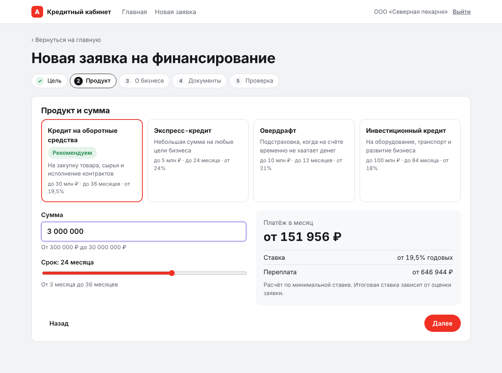
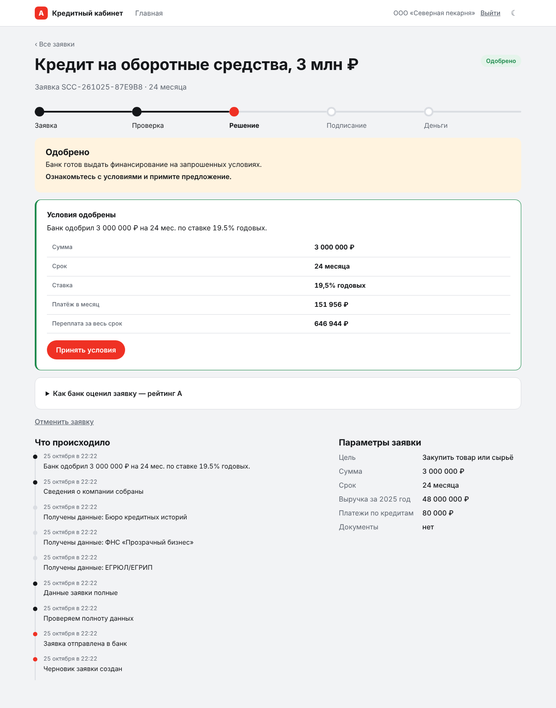
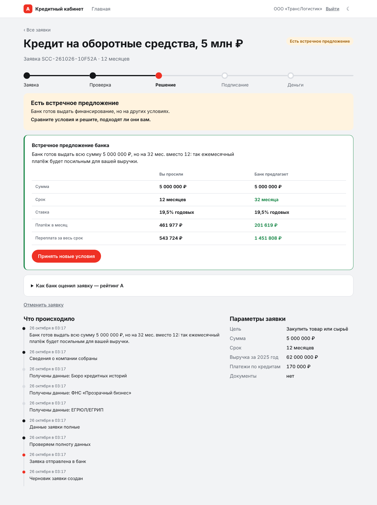
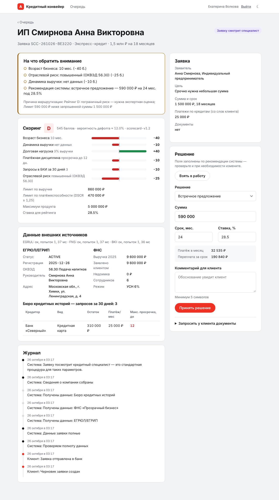
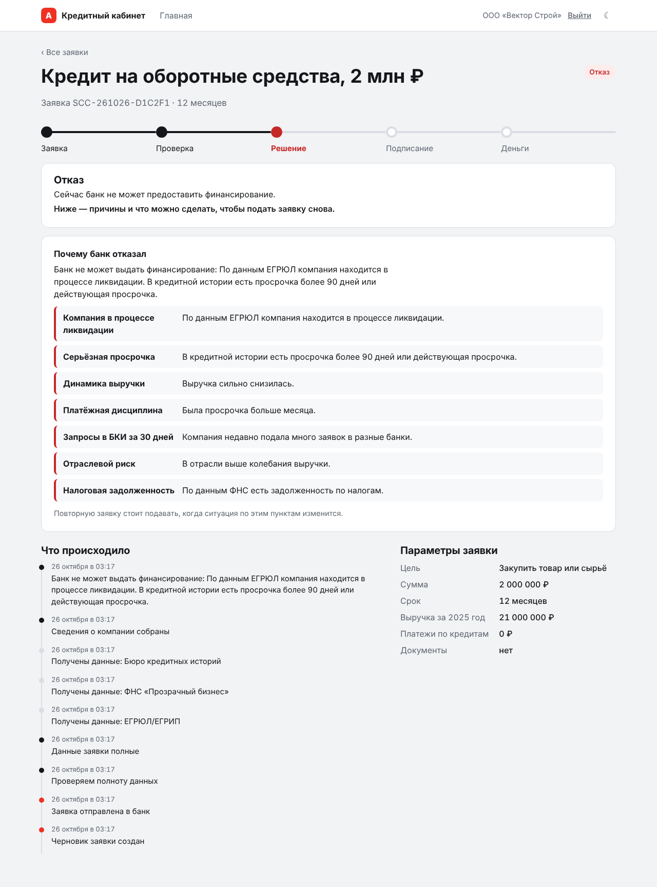
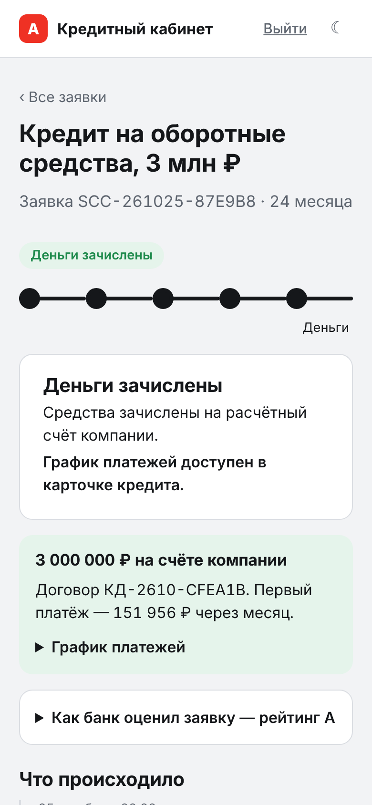

# Умный кредитный кабинет предпринимателя

Прототип цифрового кредитного конвейера для малого и микробизнеса. Клиентский путь и внутренняя обработка заявки объединены в один управляемый процесс: от потребности в деньгах до зачисления на счёт.

Предприниматель описывает задачу своими словами или выбирает цель, получает подходящий продукт и расчёт платежа, отправляет заявку и видит, что с ней происходит. Банк автоматически проверяет полноту данных, получает сведения из ЕГРЮЛ/ЕГРИП, ФНС и бюро кредитных историй, считает объяснимый скоринг и принимает решение: одобрение, встречное предложение, отказ, дозапрос сведений или передача кредитному аналитику. Подписание и выдача смоделированы.

> Хакатон «Альфа-Будущее» · кейс «Умный кредитный кабинет предпринимателя». Все данные синтетические, внешние сервисы — локальные симуляторы.

## Быстрый старт

Нужны Docker 24+ и Docker Compose v2. Сеть нужна только для скачивания образов при первой сборке.

```bash
git clone <repo> && cd smart-credit-cabinet
docker compose up --build        # или: make up
```

Через 1–2 минуты откройте **http://localhost:8080**. На странице входа есть кнопки демо-аккаунтов — пароль вводить не нужно.

| Адрес | Что там |
|---|---|
| http://localhost:8080 | Веб-интерфейс (клиент и аналитик) |
| http://localhost:8000/docs | Swagger UI — интерактивное описание API |
| http://localhost:8000/openapi.json | Спецификация OpenAPI 3.1 |
| http://localhost:8090/docs | Симулятор ЕГРЮЛ, ФНС, БКИ |

Быстрая автоматическая проверка всего пути (≈15 секунд): `make smoke`.
Тесты: `make test` (юнит-тесты домена и сквозные API-сценарии в контейнере).
С локальной языковой моделью: `make up-ai` (скачает ~1 ГБ весов Qwen2.5 1.5B).

## Демо-стенд на внешнем сервере

Чтобы жюри могло работать с прототипом без локального запуска, стенд разворачивается на любой ВМ с Ubuntu одной командой: `bash scripts/deploy.sh` (наружу открыт только порт 80, секреты генерируются автоматически). Инструкция и решение типовых проблем — [docs/deploy.md](docs/deploy.md), сценарий показа — [docs/demo-script.md](docs/demo-script.md).

## Пошаговый сценарий проверки

Полное описание с ожидаемыми результатами — в [docs/test-scenarios.md](docs/test-scenarios.md). Коротко:

1. **Одобрение.** Войдите как «Северная пекарня» → «Получить финансирование» → цель «Закупить товар или сырьё» → оборотный кредит 3 000 000 ₽ на 24 месяца → выручка 48 000 000 и 41 000 000 ₽, платежи 80 000 ₽ → «Отправить заявку». На маршруте заявки видно, как банк проходит этапы проверки (≈6 секунд), затем появляется одобрение и разбор оценки. Примите условия, подпишите (ИНН `7708123450`) — через пару секунд деньги «на счёте».
2. **Встречное предложение.** «ТрансЛогистик»: 5 000 000 ₽ на 12 месяцев, выручка 62 и 58 млн, платежи 170 000 ₽. Банк предложит ту же сумму на 32 месяца и покажет, как упал ежемесячный платёж.
3. **Дозапрос.** «Агро Плюс»: 3 000 000 ₽ на 18 месяцев, выручка **30** млн (ФНС видит 18 млн). Банк попросит подтвердить выручку → загрузите любой PDF как «Бухгалтерская отчётность» → «Отправить ответ» → встречное предложение на меньшую сумму.
4. **Ручное рассмотрение.** «ИП Смирнова»: экспресс-кредит 1 500 000 ₽ на 18 месяцев, выручка 9 600 000 ₽, платежи 25 000 ₽. Рейтинг D → заявка уходит специалисту. Во второй вкладке войдите как аналитик: заявка в очереди, видны факторы скоринга, данные источников и рекомендация системы. Примите решение — клиент увидит его без перезагрузки.
5. **Отказ.** «Вектор Строй» — компания в ликвидации: отказ по стоп-фактору с объяснением.
6. **Отказоустойчивость.** Аналитик → «Включить сбои источников» → подайте заявку любым клиентом: конвейер повторит запросы, разомкнёт circuit breaker и передаст заявку специалисту, а не зависнет.
7. **Ваши заявки и предложения.** На главной клиента — что нужно сделать по заявкам, что изменилось и что банк готов предложить. После выдачи кредита у пекарни появится предодобренный овердрафт; советы по заявке подбираются по форме бизнеса (ООО или ИП) и продуктам из заявок, у каждой карточки подпись «почему вы это видите».

### Скриншоты

Сняты на живом стенде (API, два воркера, симулятор, PostgreSQL); все экраны — в [docs/screenshots](docs/screenshots).

| Мастер заявки | Одобрение и разбор оценки | Встречное предложение |
|---|---|---|
|  |  |  |
| **Карточка аналитика** | **Отказ по стоп-фактору** | **Телефон, 390 px** |
|  |  |  |

### Демо-аккаунты

Свою компанию можно подключить на странице входа: «Зарегистрироваться по ИНН». Название, форма бизнеса и ОКВЭД подтянутся из реестра; подойдёт любой корректный ИНН (например, `5003001259`) — симулятор сгенерирует для него данные.

| Email | Пароль | Роль | Сценарий |
|---|---|---|---|
| bakery@demo.ru | demo12345 | Клиент, ООО | Автоодобрение, история выданного кредита |
| logistic@demo.ru | demo12345 | Клиент, ООО | Встречное предложение: дольше срок |
| agro@demo.ru | demo12345 | Клиент, ООО | Расхождение с ФНС → дозапрос |
| coffee@demo.ru | demo12345 | Клиент, ИП | Ручное рассмотрение |
| build@demo.ru | demo12345 | Клиент, ООО | Отказ по стоп-фактору |
| it@demo.ru | demo12345 | Клиент, ООО | Крупная заявка — уже в очереди аналитика |
| analyst@alfa.demo | analyst12345 | Кредитный аналитик | Очередь, решения |
| analyst2@alfa.demo | analyst12345 | Кредитный аналитик | Проверка конфликта назначения |
| risk@alfa.demo | risk12345 | Риск-менеджер | «Политика и аудит»: параметры политики, очередь задач, журнал; заявки — только просмотр |

## Архитектура



| Компонент | Технология | Ответственность |
|---|---|---|
| `web` | nginx 1.27, HTML + CSS + TypeScript 5.6 без фреймворка | Интерфейс клиента и аналитика, reverse proxy, CSP |
| `api` | Python 3.12, FastAPI, SQLAlchemy 2, Pydantic 2 | REST API, аутентификация, авторизация, команды над заявкой |
| `worker` | тот же образ, `python -m app.worker`, 2 реплики | Автоматическая обработка заявок и выдача из очереди в БД |
| `migrate` | Alembic + сидер | Миграции схемы и синтетические данные, однократно при старте |
| `db` | PostgreSQL 16 | Заявки, журнал событий, документы, очередь задач |
| `mocks` | FastAPI | Симулятор ЕГРЮЛ/ЕГРИП, ФНС «Прозрачный бизнес», БКИ; режим сбоев |
| `ollama` | Ollama + Qwen2.5 1.5B (профиль `ai`) | Разбор свободного текста клиента. Необязателен |

Ключевые решения (подробнее — [docs/decisions.md](docs/decisions.md)):

- **Доменное ядро без фреймворков** (`backend/app/domain`). Машина состояний, валидация, скоринг, кредитная политика и подбор персональных предложений — чистый Python. Их можно тестировать без БД и переиспользовать в любом транспорте.
- **Машина состояний — единственный источник правды.** Каждый переход разрешён только определённой роли (клиент, система, аналитик). Диаграмма в документации генерируется из того же кода.
- **Скоринг отделён от кредитного решения.** Скоринг даёт рейтинг и объяснимые факторы. Политика превращает рейтинг в условия конкретного продукта: лимит по выручке, лимит по платёжеспособности (DSCR ≥ 1,25), подбор встречного предложения.
- **Transactional outbox.** Смена статуса, запись в журнал и постановка задачи происходят в одной транзакции. Воркеры забирают задачи через `FOR UPDATE SKIP LOCKED`, масштабируются горизонтально. Шаги обработки идемпотентны и возобновляемы.
- **Деградация вместо отказа.** Недоступный внешний источник → retry с экспоненциальной задержкой → circuit breaker → заявка уходит специалисту с пометкой, клиент продолжает видеть понятный статус.
- **ИИ только там, где он полезен.** Модель с открытыми весами переводит свободный текст в цель и сумму. Подбор продукта, скоринг и решение остаются детерминированными и объяснимыми. Без модели работает разбор по ключевым словам.

Документация в `docs/`: [архитектура](docs/architecture.svg), [диаграмма состояний](docs/state-diagram.svg), [модель данных](docs/data-model.md), [описание API](docs/api.md), [коллекция Postman](docs/postman_collection.json), [тестовые сценарии](docs/test-scenarios.md), [кредитная логика](docs/credit-logic.md), [продуктовые решения и MVP](docs/decisions.md), [развёртывание](docs/deploy.md), [сценарий демонстрации](docs/demo-script.md).

## Структура репозитория

```
backend/
  app/domain/        машина состояний, продукты, валидация, скоринг, политика, предложения и советы — без зависимостей
  app/services/      сценарии заявки, конвейер, блок «Ваши заявки и предложения», ассистент
  app/integrations/  шлюз к внешним источникам, retry, circuit breaker
  app/api/           HTTP-роутеры и сериализация
  app/worker.py      воркер очереди задач
  app/seed.py        синтетические данные
  app/smoke.py       сквозная проверка стенда
  migrations/        Alembic
  tests/             юнит-тесты домена и API-сценарии
mocks/               симулятор ЕГРЮЛ/ЕГРИП, ФНС, БКИ + данные демо-компаний
frontend/            HTML, CSS, TypeScript, nginx
docs/                схемы, API, сценарии, решения
```

## Требования к окружению

Docker 24+ с Compose v2, 2 ГБ свободной памяти (4 ГБ с профилем `ai`), свободные порты 8080, 8000, 8090. Если порт занят (ошибка `port is already allocated`), задайте другой в `.env`: `WEB_PORT`, `API_PORT`, `MOCKS_PORT` — и откройте интерфейс по новому адресу.

Для разработки без Docker: Python 3.12, Node.js 20+, PostgreSQL 16 (или SQLite для тестов).

```bash
cd backend && pip install -r requirements-dev.lock
DATABASE_URL=sqlite:///./dev.db PIPELINE_MODE=inline PIPELINE_STEP_DELAY_SEC=0 pytest
cd frontend && npm ci && npm run build
```

## Конфигурация

Все переменные необязательны; значения по умолчанию подходят для локального запуска. Шаблон — `.env.example`.

| Переменная | По умолчанию | Назначение |
|---|---|---|
| `DATABASE_URL` | `postgresql+psycopg://scc:scc@db:5432/scc` | Подключение к БД |
| `JWT_SECRET` | dev-значение | Секрет подписи токенов. При `APP_ENV=production` обязателен |
| `JWT_TTL_MINUTES` | `480` | Время жизни сессии |
| `INTEGRATIONS_URL` | `http://mocks:8090` | Адрес внешних источников |
| `INTEGRATIONS_TIMEOUT_SEC` / `INTEGRATIONS_RETRIES` | `3` / `2` | Таймаут и число повторов |
| `PIPELINE_MODE` | `worker` | `worker` — очередь и воркер, `inline` — синхронно (тесты) |
| `PIPELINE_STEP_DELAY_SEC` | `1.5` | Пауза между шагами конвейера, чтобы на демо было видно движение статусов. `0` — без пауз |
| `AUTO_DECISION_LIMIT` | `15000000` | Сумма, выше которой решение принимает только аналитик |
| `WORKER_REPLICAS` | `2` | Число воркеров |
| `WEB_PORT`, `API_PORT`, `MOCKS_PORT` | `8080`, `8000`, `8090` | Внешние порты интерфейса, API и симулятора на вашем компьютере |
| `MAX_UPLOAD_BYTES` | `10485760` | Максимальный размер документа |
| `LLM_URL` / `LLM_MODEL` | `http://ollama:11434` / `qwen2.5:1.5b` | Локальная модель. Пустой `LLM_URL` отключает LLM |
| `SEED_DEMO_DATA` | `true` | Загружать синтетические данные |

## Безопасность и надёжность

Пароли — PBKDF2-SHA256 (310 000 итераций). Сессии — JWT HS256 с ограниченным сроком. Ролевой доступ на уровне эндпоинтов и проверка владельца на уровне объекта: чужая заявка неотличима от несуществующей (404). Внутренние лимиты банка не отдаются клиенту.

Строгая CSP и защитные заголовки в nginx. DOM строится только через `textContent`, что исключает XSS. Документы проверяются по типу и размеру, хранится SHA-256. В логах ИНН маскируется. Логи — JSON с `request_id`, сквозным от nginx до API.

Идемпотентное создание и отправка заявки (`Idempotency-Key`, повторная отправка безопасна). Оптимистическая блокировка (`version`). Неизменяемый журнал событий. Health-эндпоинты `/health/live` и `/health/ready`. Контейнеры работают от непривилегированного пользователя.

## Ограничения прототипа

Подписание (ПЭП) и выдача денег смоделированы. Внешние источники — симуляторы с упрощёнными контрактами. Документы хранятся в БД; в промышленной версии их место — объектное хранилище с антивирусной проверкой. Регистрация клиента упрощена: по ИНН, email и паролю, без проверки личности (KYC) и подтверждения полномочий — реквизиты компании берутся из симулятора ЕГРЮЛ/ЕГРИП. Скоринговая карта экспертная, без обучения на исторических данных. Полный список и план развития — в [docs/decisions.md](docs/decisions.md).