# Модель данных

Исходник диаграммы — [data-model.mmd](data-model.mmd); миграция — `backend/migrations/versions/0001_initial.py`.

| Таблица | Назначение | Важное |
|---|---|---|
| `companies` | Клиент банка — ООО или ИП | `inn` уникален; ОКВЭД используется в отраслевом риске скоринга, форма бизнеса — в подборе советов по заявке |
| `users` | Представители компаний и сотрудники банка | `role`: `CLIENT`, `ANALYST`, `RISK_ADMIN`; у клиента есть `company_id` |
| `applications` | Заявка — центральный объект конвейера | `status` меняется только через машину состояний; `version` — оптимистическая блокировка; `idempotency_key` уникален |
| `application_events` | Неизменяемый журнал: переходы статусов, документы, обращения к источникам, комментарии | `visible_to_client=false` — внутренние события (сбои источников, назначение аналитика) |
| `documents` | Файлы клиента | `sha256` для целостности; содержимое загружается отложенно |
| `info_requests` | Дозапросы от системы или аналитика | `items` — список полей и документов; `OPEN` → `ANSWERED` |
| `jobs` | Очередь задач (transactional outbox) | `PROCESS_APPLICATION`, `DISBURSE`; повторы с экспоненциальной задержкой |

## JSON-поля заявки

Результаты этапов хранятся как снимки, чтобы решение можно было воспроизвести и объяснить даже после изменения политики.

- `enrichment` — ответы ЕГРЮЛ, ФНС, БКИ и метаданные вызовов (`attempts`, `latency_ms`, ошибки).
- `scoring` — баллы, грейд, PD, каждый фактор с вкладом, стоп-факторы, версия скоринговой карты и входные данные модели.
- `decision` — исход, причины, лимиты (по выручке, по платёжеспособности, по продукту), объяснение для клиента, рекомендация системы при ручном рассмотрении, версия политики; после аналитика — блок `manual`.
- `offer` — действующие условия: сумма, срок, ставка, платёж, переплата.
